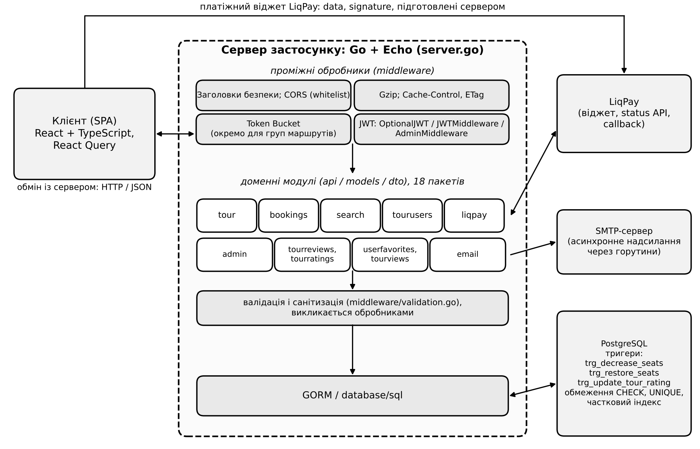
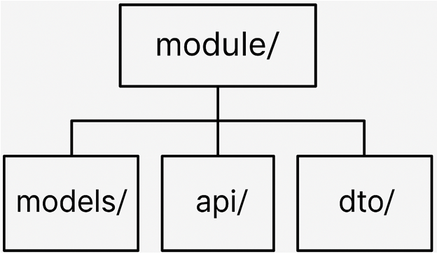
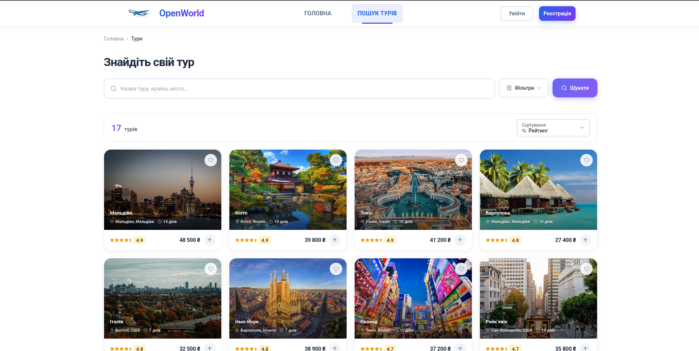
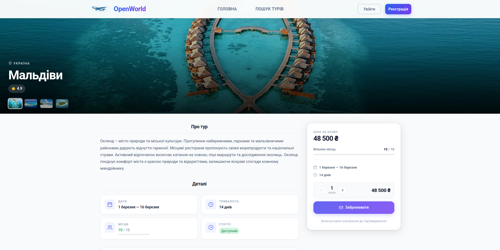

# OpenWorld — вебзастосунок для онлайн-бронювання турів

OpenWorld — повнофункціональний вебзастосунок туристичної агенції: каталог турів із пошуком і
фільтрацією, бронювання місць (зокрема гостьове, без реєстрації), онлайн-оплата через LiqPay,
особистий кабінет користувача, коментарі й оцінки, а також адміністративна панель з аналітикою.


## Зміст

- [Можливості](#можливості)
- [Стек технологій](#стек-технологій)
- [Архітектура](#архітектура)
- [Структура репозиторію](#структура-репозиторію)
- [Запуск проєкту](#запуск-проєкту)
- [Тестування](#тестування)
- [Основні маршрути API](#основні-маршрути-api)
- [Знімки екрана](#знімки-екрана)
- [Автор](#автор)

## Можливості

**Для користувача**
- каталог турів, слайдер на головній сторінці, сторінка туру з галереєю зображень;
- пошук турів за назвою, країною, ціною, тривалістю та рейтингом, з сортуванням і пагінацією;
- реєстрація, вхід (JWT), відновлення пароля через email;
- бронювання туру авторизованим користувачем або гостем; скасування бронювання;
- онлайн-оплата через LiqPay (sandbox), посилання «оплатити пізніше» для гостей;
- коментарі з відповідями та реакціями, оцінки турів, обрані тури, історія переглядів;
- email-сповіщення про створення, оплату та скасування бронювання.

**Для адміністратора**
- аналітичний дашборд: кількість турів, бронювань, користувачів, дохід, графіки за місяцями, популярні тури;
- керування турами (створення, редагування, деактивація, завантаження зображень);
- керування бронюваннями (зміна статусу з автоматичним перерахунком місць) і експорт у CSV;
- перегляд користувачів та історії їхніх бронювань.

**Цілісність і безпека даних**
- облік вільних місць тригерами PostgreSQL (`trg_decrease_seats`, `trg_restore_seats`) з блокуванням рядка `SELECT … FOR UPDATE`;
- автоматичний перерахунок рейтингу туру тригерами (`trg_update_tour_rating`, `trg_update_tour_rating_from_ratings`);
- обмеження `CHECK`, `UNIQUE`, зовнішні ключі; ціна бронювання обчислюється лише на сервері;
- перевірка підпису LiqPay (SHA-1 + Base64) і запит фактичного статусу платежу через status API;
- обмеження частоти запитів (Token Bucket), валідація та санітизація вхідних даних, заголовки безпеки, CORS;
- паролі зберігаються лише як bcrypt-хеші, секрети передаються через змінні середовища.

## Стек технологій

| Рівень | Технології |
|---|---|
| Серверна частина | Go 1.23+, Echo v4, GORM, PostgreSQL-драйвер pgx, golang-jwt, bcrypt, go-playground/validator |
| База даних | PostgreSQL 14+ (тригери та функції PL/pgSQL) |
| Клієнтська частина | React 18, TypeScript, React Router, TanStack React Query, HeroUI, Tailwind CSS, Recharts, Swiper |
| Інтеграції | LiqPay (платежі), SMTP (email-сповіщення) |
| Інструменти | Git, GitHub, Air (автоперезапуск сервера), Create React App, `hey` (навантажувальне тестування) |

Залежності описано у файлах `tour-server/go.mod` (Go) та `tour/package.json` (Node.js);
бенчмарк-сервери мають власні `benchmark/go/go.mod`, `benchmark/express/package.json`,
`benchmark/fastapi/requirements.txt`.

## Архітектура



Клієнт (SPA на React) обмінюється з сервером JSON-повідомленнями через REST API. Сервер на Go + Echo
пропускає запити через ланцюжок проміжних обробників (заголовки безпеки, CORS, стиснення,
обмеження частоти, перевірка JWT), після чого їх обробляють доменні модулі. Кожен модуль має
однакову структуру `api/` (обробники), `models/` (моделі GORM), `dto/` (об'єкти передачі даних):



Додаткові діаграми (варіанти використання, послідовність бронювання й оплати, діяльність) —
у каталозі [`docs/diagrams`](docs/diagrams).

## Структура репозиторію

```
.
├── tour-server/                 # серверна частина (Go + Echo + GORM)
│   ├── server.go                # точка входу: middleware, маршрути, запуск сервера
│   ├── config/                  # завантаження конфігурації (config.example.yaml — шаблон)
│   ├── database/                # підключення до PostgreSQL
│   ├── db/schema.sql            # схема бази даних: таблиці, індекси, тригери
│   ├── migration_catchup.sql    # доповнення схеми та демонстраційні дані
│   ├── middleware/              # JWT, rate limiter, валідація, кешування, безпека
│   ├── admin/ bookings/ liqpay/ search/ tour/ tourusers/ ...  # доменні модулі
│   ├── email/                   # шаблони та надсилання листів
│   ├── static/                  # зображення турів
│   ├── go.mod, go.sum           # залежності Go
│   └── .env.example             # шаблон змінних середовища
├── tour/                        # клієнтська частина (React + TypeScript)
│   ├── src/                     # сторінки, компоненти, хуки, сервіси API
│   ├── public/
│   ├── package.json             # залежності Node.js
│   └── .env.example
├── benchmark/                   # порівняльне тестування Go / Python / Node.js
├── docs/                        # діаграми та знімки екрана
├── .gitignore
└── README.md
```

## Запуск проєкту

### Вимоги

- [Go](https://go.dev/dl/) 1.23 або новіший;
- [Node.js](https://nodejs.org/) 18 або новіший разом із npm;
- [PostgreSQL](https://www.postgresql.org/download/) 14 або новіший;
- [Git](https://git-scm.com/).

### 1. Клонування репозиторію

```bash
git clone https://github.com/H1vee/Travel-agency.git
cd Travel-agency
```

### 2. База даних

Створіть користувача та базу даних (пароль замініть на власний):

```bash
sudo -u postgres psql -c "CREATE ROLE touruser LOGIN PASSWORD 'your_password';"
sudo -u postgres psql -c "CREATE DATABASE tourdb OWNER touruser;"
```

Створіть структуру бази й завантажте демонстраційні дані (5 турів, локації, два облікові записи):

```bash
psql -h 127.0.0.1 -U touruser -d tourdb -f tour-server/db/schema.sql
psql -h 127.0.0.1 -U touruser -d tourdb -f tour-server/migration_catchup.sql
```

Демонстраційні облікові записи: `admin@openworld.local` / `admin123` (адміністратор)
та `user@openworld.local` / `user123` (користувач). Для реального розгортання змініть їхні паролі.

### 3. Серверна частина

```bash
cd tour-server
cp config/config.example.yaml config/config.yaml
cp .env.example .env
```

У файлі `.env` вкажіть щонайменше `DB_PASSWORD` і `JWT_SECRET`
(наприклад, згенерований командою `openssl rand -hex 32`). Ключі LiqPay та SMTP потрібні лише
для оплати й email-сповіщень; без SMTP сервер працює, а листи не надсилаються.

```bash
go mod download
go run .
```

Сервер запуститься на `http://127.0.0.1:1323`. Для автоматичного перезапуску під час розробки
можна використати [Air](https://github.com/air-verse/air): команда `air` у каталозі `tour-server`.

### 4. Клієнтська частина

В іншому терміналі:

```bash
cd tour
cp .env.example .env
npm install
npm start
```

Застосунок відкриється на `http://localhost:3006`. Продакшн-збірка: `npm run build`
(результат у каталозі `tour/build`, який не зберігається в репозиторії).

### Оплата LiqPay

Для перевірки оплати зареєструйтеся в [LiqPay](https://www.liqpay.ua/), отримайте sandbox-ключі
та вкажіть їх у `LIQPAY_PUBLIC_KEY` і `LIQPAY_PRIVATE_KEY`. Підтвердження оплати працює через
`POST /liqpay/confirm`; серверний callback (`LIQPAY_CALLBACK_URL`) потребує публічної адреси сервера.

## Тестування

```bash
cd tour-server
go test ./...
```

Набір містить 44 автоматизовані тести та 24 вкладені перевірки (68 перевірок) для пакетів
`admin/api`, `bookings/api`, `liqpay`, `liqpay/api`, `middleware`, `tourusers/api`.
HTTP-запити до обробників імітуються пакетом `net/http/httptest`, тому база даних для тестів не потрібна.

Порівняльне навантажувальне тестування Go, Python і Node.js описано в [`benchmark/README.md`](benchmark/README.md).

## Основні маршрути API

| Метод | Маршрут | Призначення | Доступ |
|---|---|---|---|
| GET | `/tours`, `/tours/:id`, `/cards`, `/tourswiper` | список і деталі турів | усі |
| GET | `/search` | пошук із фільтрами та пагінацією | усі |
| GET | `/tour-seats/:id`, `/tour-carousel/:id` | вільні місця, галерея | усі |
| POST | `/auth/register`, `/auth/login` | реєстрація, вхід | усі |
| POST | `/auth/forgot-password`, `/auth/reset-password` | відновлення пароля | усі |
| POST | `/tour/bookings` | створення бронювання | гість або користувач |
| PUT | `/bookings/:id/cancel` | скасування бронювання | користувач |
| POST | `/liqpay/create-payment`, `/liqpay/confirm` | оплата | гість або користувач |
| POST | `/liqpay/callback` | серверне сповіщення LiqPay | LiqPay |
| GET/PUT | `/profile` | профіль користувача | користувач |
| GET/POST/DELETE | `/user-favorites` | обрані тури | користувач |
| GET/POST/PUT/DELETE | `/tour-comments` | коментарі та реакції | гість або користувач |
| GET | `/admin/analytics/*` | аналітика | адміністратор |
| GET/POST/PUT/DELETE | `/admin/tours` | керування турами | адміністратор |
| GET/PUT | `/admin/bookings`, `/admin/bookings/:id/status` | керування бронюваннями | адміністратор |
| GET | `/admin/bookings/export` | експорт бронювань у CSV | адміністратор |

Повний перелік маршрутів — у файлі `tour-server/server.go`.

## Знімки екрана

| Пошук турів | Сторінка туру |
|---|---|
|  |  |

## Автор

Лединський Артем Олександрович, група 441А,
кафедра математичних проблем управління і кібернетики,
Чернівецький національний університет імені Юрія Федьковича.
Email: ledynskyi.artem@chnu.edu.ua
